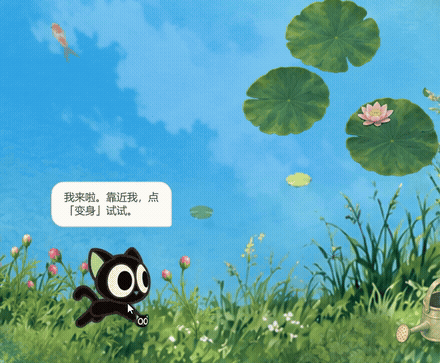

# 小黑和嘿咻 · 桌面伙伴

**3.8.0** · Windows 10 / 11 · 个人同人作品

使用同一份 AI 重绘透明图集，提供 Codex 原生萌宠外观和可独立运行的桌面伙伴。独立版也逐帧播放真实动作，配有动作面板与可编辑配置。

以下预览把 Windows 独立版的实际动画帧叠在桌面背景上。猫形与人形使用相同的镜头倍率。



[观看带互动音效的演示视频](media/demo.mp4) · [查看分享封面](media/01-封面.png) · [猫形与人形同倍率对照](media/变身前后.png) · [皇受与比丢的八个动作](media/来客动作.png)

## 下载与更新

**[下载 Windows 桌面版](https://github.com/mkqxy/xiaohei-companion/releases/latest/download/Xiaohei-Windows.zip)** · [下载 Codex 原生外观](https://github.com/mkqxy/xiaohei-companion/releases/latest/download/Xiaohei-Codex-Pet.zip) · [版本说明和源码](https://github.com/mkqxy/xiaohei-companion/releases/latest)

Windows 桌面版适合直接使用。右键旧版小黑，选「退出小黑」，再将 ZIP 全部解压到普通文件夹，双击「启动小黑.cmd」。已有的随手记和设置继续保存在原来的用户目录。

如果想让 Codex 原生浮窗显示小黑、跟随任务状态，选 `小黑-Codex原生外观.zip`。双击安装脚本后，按下面的「原生版」步骤在应用中选中小黑。

`小黑桌宠-3.8-源码.zip` 提供完整源码、离线配置编辑器、原生外观与构建脚本。开发者可按照[本地构建说明](docs/build.md)生成 EXE；使用打包脚本生成的 Native、Portable、Source 三种 ZIP 也可按下文操作。
## 原生版：三步使用

1. 解压 Native ZIP，双击 `Install-Native.cmd`。无需管理员权限。
2. 打开 Codex / ChatGPT 桌面应用的 **设置 → Pets / 萌宠 → Refresh / 刷新**，选择「小黑和嘿咻」。
3. 在聊天框输入 `/pet` 显示浮窗。按住小黑左右拖动，可以看到对应方向的跑步动画。

原生浮窗使用应用自带的工作、等待输入、完成和受阻状态，以及铃铛活动列表。外观包不向原生菜单注入独立版工具或任意动作命令。任务里的 `Running` 是专注工作，和左右跑步是不同动作。[原生交互说明](docs/native-actions.md)

若设置里的预览是小黑，桌面仍是蓝色机器人：先点 Pets 页的 **Refresh**；仍未更新时，**完全退出应用再重开**。只关闭主窗口或用 `/pet` 隐藏浮窗可能保留旧浮窗进程。本作品已遇到并通过完整重启解决过这一情况。

## 独立版：三步使用

1. 解压 Portable ZIP 到普通文件夹，保留整份目录。
2. 双击 `XiaoheiCompanion.exe` 或 `Start-Companion.cmd`。
3. 把鼠标移到小黑身边，上方会出现五个图标。从左到右是变身、分身、皇受、比丢、工具。把指针停在图标上可查看名称。轻点小黑会回应，双击小跳。右键打开口袋，可以修改个性化设置或展开「全部动作」。

## 3.8 的玩法

轻点脚边的嘿咻，看它跳上小黑头顶，眯一会儿再下来。轻点猫形小黑偶尔能听到一声真实的幼猫叫；长按有呼噜，吃鱼干有轻响。散步、跳跃和变身保留安静的动作。在口袋的「设置 → 小黑的声音」可以调音量或试听。[声音与互动说明](docs/sound.md)

右键小黑，选「在桌面散步」，移开鼠标就能看它走走停停。再选「停下散步」就会留在当前位置。也可以从口袋的「陪伴」页勾选「让小黑在附近散步」。拎起来会轻晃，放下时有落地缓冲。

点「变身」，小黑会从任务栏边的坐姿变成高一截的绿眼睛少年。两种形态共用一个大小设置。以 36% 为例，猫形待机时高约 104 个逻辑像素，人形站立时高约 159 个。切回猫形就坐回原来那一行。

- 点「变身」切换猫形和人形，重开程序会记住上次的选择。点「分身」，尾巴贴地回钩，三个嘿咻从尾尖依次弹落，和右脚边的伙伴聚成四只。再点可提前召回。
- 拖近底部任务栏，松手后小黑会贴住任务栏上沿；向上拖开即可自由摆放。右键调节「桌宠大小」（28%–100%），鼠标放在小黑身上时也可以按 Ctrl 滚动滚轮。
- 点「皇受」叫小皇来串门。再点按钮或点它，看它扑叶、蹭小黑。「比丢」会吞食、鼓肚、变色。右键菜单里的「嘿咻捉迷藏」可以直接开一局。
- 点「工具」输入 1–180 分钟，开始或继续专注时口袋自动收起。点头顶的倒计时可以再次打开工具，暂停或结束本轮。
- 天气工具会尝试从 Windows 获取已许可的位置，用大致坐标向 Open-Meteo 查询当地天气。也可以输入城市查询。网络和系统位置服务的状态会显示在工具内。[天气数据](https://open-meteo.com/en/docs)
- 小黑猫形和人形、尾巴分身及伙伴设定参考[动画官方角色页](https://luoxiaohei-movie.com/tv/character/)、[第三话《嘿》](https://www.bilibili.com/bangumi/play/ep32372)、[第四话《飘》](https://www.bilibili.com/bangumi/play/ep32371)及[正片第七话《比丢》](https://www.bilibili.com/bangumi/play/ep32368)。按钮和桌面小游戏为同人实现。

角色互动、专注、随手记和配置编辑均可离线使用。查看新天气需要联网。Windows 桌面版可独立使用，无需安装 Codex 或另行配置 API 密钥。

## 个性化，不必先学写代码

- 打开 `editor/index.html`，在本机浏览器里预览图集和编辑配置。
- 导出配置 JSON，再从独立版设置导入；示例位于 `profiles/default.json`。
- 动作按钮可以组合“播放一种已有动画 + 说一句话”。导入配置不执行脚本、终端命令或外部程序。
- 替换角色可导入自己制作的透明 PNG 图集。规格是 **1536 × 2288、8 列 × 11 行、单格 192 × 208**。九类标准动作和十六个视线方向保持固定顺序。

[配置字段与图集规范](docs/customization.md) · [脚本调用](docs/integration.md) · [安装与卸载](docs/install.md) · [发布说明](docs/publishing.md)

开发者可以直接调用：`.\XiaoheiCompanion.exe --action waving --message "今天也加油"`。已启动时把动作发送给现有独立版实例；未启动时先启动程序。这个命令不会操作 Codex 原生萌宠。

## 固定下载入口

可用 GitHub Releases 维护同一个最新版说明页和下载地址。源码里的发布工作流会在推送版本标签后构建、测试、打包并发布，附件使用固定名称 Xiaohei-Windows.zip。[发布工具与首次设置](docs/releases.md)

## 项目目录

```text
src/                WPF 程序与精灵播放逻辑
assets/xiaohei/      独立版默认透明 PNG 图集
native/             Codex 原生 v2 外观包
profiles/           可导入配置示例
editor/             浏览器离线编辑器
scripts/            安装、打包与安装器验证脚本
tests/              计时、状态、图集和界面检查
media/              实际图集生成的预览与分享图片
```

在 Windows PowerShell 中运行 `powershell -NoProfile -ExecutionPolicy Bypass -File .\Build.ps1` 构建，再运行 `powershell -NoProfile -ExecutionPolicy Bypass -File .\Test.ps1`。构建使用 Windows 的 .NET Framework 编译器，不下载依赖。[Microsoft 编译器说明](https://learn.microsoft.com/en-us/dotnet/csharp/language-reference/compiler-options/)

## 开源范围

**原创代码、脚本、文档：MIT。角色与角色衍生素材：不包含在代码的 MIT 授权内。** 小黑和嘿咻相关权益归各自权利方所有；本项目不是官方产品，也不声称取得角色商用或再授权权利。使用自己的角色做二次开发时，请替换相应素材并写明自己的素材许可。

[代码许可](LICENSE) · [素材说明](ASSET_NOTICE.md)

## 已知范围

- 独立版目前仅提供 Windows 版本；原生包需要桌面应用本身支持自定义萌宠。
- 图片大小、系统减少动态效果、应用版本都可能影响原生显示。独立版导入的配置不会改变原生应用设置。
- 当前可执行文件未做发行者代码签名。发布时应同时提供源码和 SHA256 校验，不把未经测试的平台或功能写成已支持。
- 发布流程已准备好。仓库的公开地址、在线 CI 和其他电脑的兼容性测试情况，以实际发布和运行结果为准。
